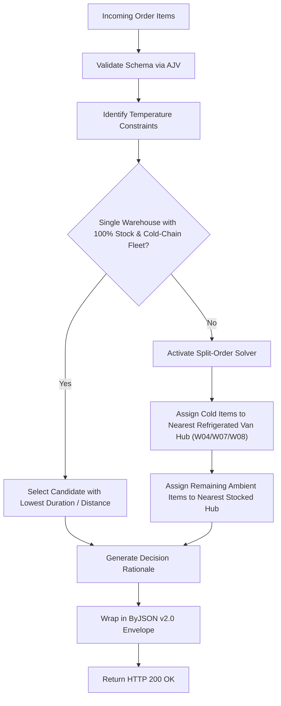

# Pharmatory

[](#prerequisites)
[](#tech-stack)
[](https://github.com/bayurkp/by-json)
[](#tech-stack)
[](#tech-stack)
[](#tech-stack)
[](#tech-stack)
[](#tech-stack)
[](#api-documentation--endpoints)

> High-performance, deterministic medical warehouse selection and order fulfillment engine engineered with **Fastify (LTS)**, **TypeScript**, **better-sqlite3**, the **ByJSON Specification (v2.0)**, **Tailwind CSS v4**, **DaisyUI v5**, **Alpine.js**, and interactive API documentation powered by **Scalar**.

---

## Table of Contents

- [Overview](#overview)
- [ByJSON v2.0 Compliance Audit](#byjson-v20-compliance-audit)
  - [Response Envelope Specification](#response-envelope-specification)
  - [Standard Error Codes & Validation Paths](#standard-error-codes--validation-paths)
  - [Query Filtering & Wire Conventions](#query-filtering--wire-conventions)
- [Domain Model & Business Rules](#domain-model--business-rules)
  - [Cold Chain Inviolability](#cold-chain-inviolability)
  - [Fulfillment Decision Engine](#fulfillment-decision-engine)
  - [In-Memory Historical Traffic Intelligence](#in-memory-historical-traffic-intelligence)
- [Architecture & Separation of Concerns](#architecture--separation-of-concerns)
  - [Project Directory Layout](#project-directory-layout)
- [API Specification & Endpoints](#api-specification--endpoints)
- [Testing Strategy](#testing-strategy)
- [Quick Start](#quick-start)
  - [Prerequisites](#prerequisites)
  - [Installation](#installation)
  - [Automated Tests](#automated-tests)
  - [Development Mode](#development-mode)
  - [Production Build & Run](#production-build--run)
- [Interactive Web Dashboard](#interactive-web-dashboard)
- [License](#license)

---

## Overview

**Pharmatory** is a deterministic warehouse selection and order fulfillment engine designed for a regional medical and pharmaceutical distribution network across East Java (Surabaya, Sidoarjo, Gresik, Pasuruan, Malang, Jember).

When orders containing multiple medical and pharmaceutical products are placed by healthcare facilities, the engine evaluates:

1. **Stock Availability**: Live inventory across 8 regional storage facilities.
2. **Cold Chain Integrity**: Biological vaccines strictly require both refrigerated warehouse storage ($2^\circ\text{C}-8^\circ\text{C}$) and active refrigerated delivery vehicles to prevent irreversible product degradation.
3. **Logistics Optimization**: Single-warehouse consolidation is prioritized to minimize freight overhead. A deterministic split-order solver activates whenever inventory or fleet constraints mandate multi-hub dispatch.
4. **Traffic Intelligence**: Empirical delivery durations from historical records are applied to predict travel times during weekday rush hours and weekend tourism corridors.
5. **In-Memory Dynamic Datasets**: Supports custom historical CSV uploads processed entirely in runtime memory with zero file storage writes.
6. **Strict ByJSON v2.0 Standard**: 100% of endpoints return the four-key **ByJSON Specification v2.0** envelope (`{ success, data, error, meta }`).

---

## ByJSON v2.0 Compliance Audit

The API strictly adheres to the official [ByJSON Specification (Version 2.0)](https://github.com/bayurkp/by-json):

### Response Envelope Specification

Every response contains exactly four root keys:

```typescript
export interface ApiResponse<T> {
  success: boolean // Explicit discriminator (true on 2xx, false on 4xx/5xx)
  data: T | null // Populated on success; strictly null on error
  error: ApiError | null // Populated on error; strictly null on success
  meta: ApiMeta // Request context: requestId (UUID) and timestamp (ISO 8601)
}
```

### Standard Error Codes & Validation Paths

- Machine-readable error codes strictly use `snake_case` (Section 2.3 & 7.1).
- Validation errors use **Dot Notation** for field paths (Section 5.4 A):
  ```json
  {
    "success": false,
    "data": null,
    "error": {
      "code": "validation_error",
      "message": "The request payload failed validation against the OpenAPI specification schema.",
      "details": [
        {
          "field": "items.0.quantity",
          "code": "minimum_value",
          "message": "must be >= 1"
        }
      ]
    },
    "meta": {
      "requestId": "8f830a6e-4e8c-4a37-b6e5-22e70df4ab75",
      "timestamp": "2026-10-23T12:00:00.000Z"
    }
  }
  ```
- File validation failures conform to ByJSON Table 7.1:
  - Non-CSV file uploads return HTTP 422 with `code: "unsupported_file_type"`.
  - Oversized payloads return HTTP 422 with `code: "file_too_large"`.
  - Malformed JSON payloads return HTTP 400 with `code: "bad_request"`.

### Query Filtering & Wire Conventions

- All JSON body keys and query parameters use `camelCase` (Section 2.1 & 4.5).
- Equality query filtering is supported across collections:
  - `GET /api/v1/products?coldChainRequired=true`
  - `GET /api/v1/products?category=Pharmaceutical`
  - `GET /api/v1/warehouses?location=Surabaya`
  - `GET /api/v1/warehouses?fullColdChainCapable=true`

---

## Domain Model & Business Rules

### Cold Chain Inviolability

- **Temperature-Sensitive Products**:
  - `P002`: Vaccine — Hepatitis B (10-dose vial)
  - `P004`: Vaccine — Tetanus Toxoid (10-dose vial)
- **Fleet Qualification Rules**:
  - Facilities **W02 (Surabaya)** and **W06 (Malang)** feature refrigerated storage units but **only operate standard non-refrigerated vehicles**. Delivering vaccines in non-refrigerated vehicles violates biological transport safety. Therefore, W02 and W06 are **disqualified** from fulfilling cold-chain shipments.
  - Only facilities with active refrigerated vans (**W04 Gresik**, **W07 Pasuruan**, **W08 Jember**) are qualified to dispatch vaccines.

### Fulfillment Decision Engine



### In-Memory Historical Traffic Intelligence

- **Surabaya Urban Corridor (W01, W02)**: Morning rush (07:30–08:30) and evening rush (16:30–18:00) increase transit times by up to $3\times$ (e.g., W01 increases from 12 mins off-peak to 50–55 mins).
- **Malang Corridor (W05, W06)**: Weekend tourism traffic heading to Malang (Friday afternoon / Saturday morning) increases transit times to 165–180 mins; Sunday return traffic reaches 190–200 mins.
- **In-Memory CSV Stream**: Custom CSV files uploaded via `POST /api/v1/traffic/upload` are processed directly in memory without disk persistence.

---

## Architecture & Separation of Concerns

The codebase follows a **Clean Feature-Driven Modular Architecture** inspired by official Fastify guidelines and [Node.js Best Practices](https://github.com/goldbergyoni/nodebestpractices):

1. **HTTP / Controller Layer**: Handles HTTP requests, AJV schema binding, and ByJSON envelope wrapping. Contains zero business logic and zero direct database queries.
2. **Service Layer**: Pure TypeScript domain orchestration. Decoupled from Fastify request/reply objects, ensuring platform agnosticism and isolated testability.
3. **Repository Layer**: Encapsulates raw SQLite persistence (`better-sqlite3`). Shields business logic from database driver specifics.
4. **Domain Engine (`fulfillment.engine.ts`)**: Pure deterministic logic calculating warehouse candidate scores, vehicle compatibility, and split-order combinations.

### Project Directory Layout

```text
pharmatory/
├── public/                              # Zero-build frontend presentation
│   ├── css/styles.css                   # Compiled Tailwind + DaisyUI
│   ├── js/app.js                        # Modular Alpine.js client component
│   ├── js/alpine.min.js                 # Vendored Alpine.js runtime
│   └── index.html                       # Semantic management dashboard markup
├── src/
│   ├── app.ts                           # Application factory (Fastify instance & plugins)
│   ├── server.ts                        # Entry point bootstrapper (TCP listener)
│   ├── config/                          # Central configuration
│   ├── db/                              # Persistence connection, schema, and seeder
│   ├── shared/                          # ByJSON types, helpers, and error classes
│   ├── plugins/                         # Fastify infrastructure (error-handler, swagger, static, multipart)
│   └── modules/                         # Feature domain modules
│       ├── product/                     # Product catalog domain
│       ├── warehouse/                   # Regional warehouse & inventory domain
│       ├── traffic/                     # In-memory traffic analytics & custom CSV upload
│       └── fulfillment/                 # Core warehouse selection & scoring engine
├── tests/
│   ├── unit/fulfillment.test.ts         # Deterministic domain logic unit tests
│   └── integration/api.test.ts          # End-to-end Fastify inject() API tests
├── .editorconfig                        # Cross-IDE indentation & formatting
├── .prettierrc                          # Prettier code formatting rules
├── eslint.config.js                     # ESLint v9 Flat Config + typescript-eslint
├── package.json
└── tsconfig.json
```

---

## API Specification & Endpoints

| Method | Endpoint                   | Description                                                                               |
| :----- | :------------------------- | :---------------------------------------------------------------------------------------- |
| `POST` | `/api/v1/orders/fulfill`   | Evaluates warehouse selection, cold chain compliance, and generates fulfillment plan.     |
| `GET`  | `/api/v1/products`         | Lists pharmaceutical and medical supplies. Supports `?category` and `?coldChainRequired`. |
| `GET`  | `/api/v1/warehouses`       | Lists 8 regional warehouses. Supports `?location` and `?fullColdChainCapable`.            |
| `GET`  | `/api/v1/traffic/patterns` | Returns aggregated delivery duration statistics and active trip records.                  |
| `GET`  | `/api/v1/traffic/summary`  | Read-only aggregate metrics alias conforming to ByJSON Section 6.2.                       |
| `POST` | `/api/v1/traffic/upload`   | Processes custom delivery CSV in memory (zero disk storage).                              |
| `POST` | `/api/v1/traffic/reset`    | Resets in-memory traffic models back to benchmark records.                                |
| `GET`  | `/api/health`              | Health check endpoint returning system status in ByJSON format.                           |
| `GET`  | `/docs/v1`                 | Interactive Scalar API Documentation portal.                                              |
| `GET`  | `/docs/v1/openapi.json`    | Raw OpenAPI 3.1 JSON specification.                                                       |

---

## Testing Strategy

Pharmatory uses a **pragmatic, high-ROI testing strategy** powered by Node.js native test runner (`node:test` + `node:assert/strict`) via `tsx`:

- **Domain Engine Unit Tests (`tests/unit/fulfillment.test.ts`)**: Exhaustively verifies cold-chain enforcement (disqualifying W02/W06 for vaccines), single-warehouse prioritization, deterministic split logic, and traffic penalty calculations.
- **Fastify Injection Tests (`tests/integration/api.test.ts`)**: Tests the full HTTP lifecycle using `app.inject()` without opening network ports, verifying 200 ByJSON envelopes, query filtering, 422 AJV schema validation errors, 422 unsupported file types, and 404 handlers.

Execute the test suite:

```bash
npm test
```

---

## Quick Start

### Prerequisites

- **Node.js**: `v20.x` or `v22.x` (LTS recommended)
- **NPM**: `v10.x` or higher

### Installation

```bash
npm install
```

### Automated Tests

```bash
npm test
```

### Code Quality & Linting

```bash
# Run ESLint static analysis
npm run lint

# Check formatting with Prettier
npm run format:check

# Format files automatically
npm run format
```

### Development Mode

Runs Tailwind CSS watcher and Fastify server concurrently:

```bash
npm run dev
```

### Production Build & Run

```bash
npm run build
npm start
```

The server will start at `http://localhost:3000`.

---

## Interactive Web Dashboard

Access `http://localhost:3000` to interact with the operational dashboard:

- **Order Construction Simulator**: Interactively select items, adjust quantities, choose dispatch departure times, and evaluate fulfillment decisions.
- **Decision Inspector**: Visualizes warehouse origin, cold-chain verification status, vehicle fleet types, route distance, and human-readable decision explanations.
- **Regional Inventory Matrix**: Live stock balances across all 8 facilities.
- **In-Memory CSV Stream**: Upload custom CSV files directly into memory to dynamically re-calibrate routing and duration models.

---

## License

ISC License.
